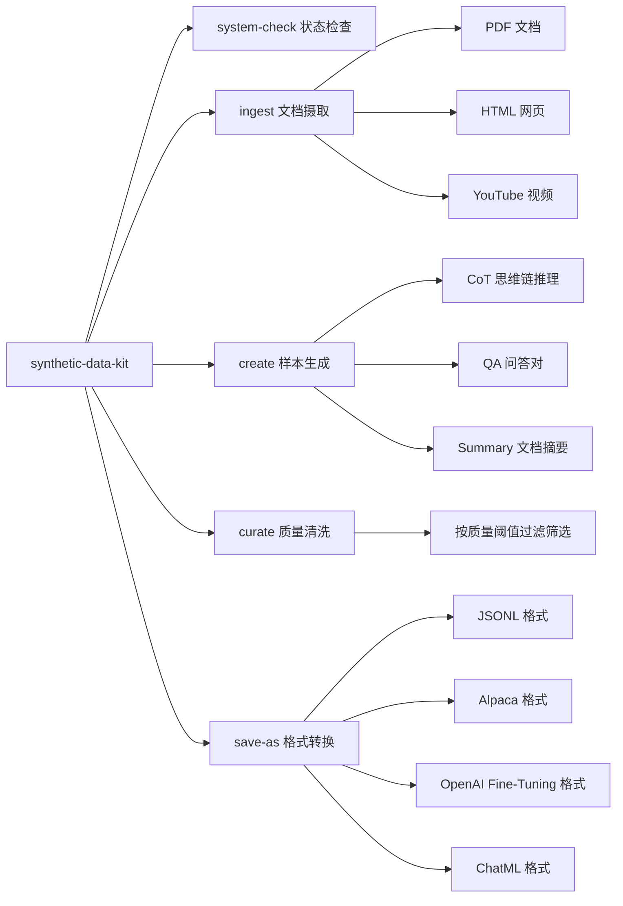

# Synthetic Data Kit (合成数据工具包)

<p align="center">
  <a href="README.md">English</a> · <b>简体中文</b>
</p>

用于生成高质量合成数据集以微调大语言模型（LLM）的高效工具。

通过简洁直观的命令行界面（CLI），一键生成思维链推理轨迹（Reasoning Traces）、问答对（QA Pairs），并轻松导出为标准的模型微调格式。

> [查看我们关于使用该工具为 Llama-3 系列模型解锁任务特定推理能力的实战指南](https://github.com/meta-llama/synthetic-data-kit/tree/main/use-cases/adding_reasoning_to_llama_3)

# Synthetic Data Kit 提供什么功能？

微调大语言模型并不困难。业界已有许多成熟的工具，可用于通过各种后训练（Post-Training）技术对 Llama 系列模型进行微调。

### 为什么专注于数据准备？

很多微调工具都支持标准化的数据格式。然而，大多数情况下，你的原始数据集并没有结构化为符合微调工具包期望的“user”、“assistant”对话轮次，或者不符合特定微调框架的输入格式。

本工具包大幅简化了以下全流程体验：

- 利用大语言模型（vLLM 或任何本地/外部 API 端点）生成高质量合成样本
- 模块化的 4 步核心命令工作流
- 将现有文档文件快速转换为易于微调的数据格式
- 创建高质量合成数据集
- 支持后训练微调所需的多种主流格式

# 它是如何运作的？

本工具采用极简的 CLI 架构，由 4 个核心命令组成：

- `ingest`：解析摄取各种常见文件格式
- `create`：生成所需的目标微调格式：普通问答对 (`QA`)、带思维链的问答对 (`CoT`)、文档摘要 (`summary`)
- `curate`：基于 LLM-as-a-Judge（以 Llama 作为裁判）对生成数据进行质量审查与打分筛选
- `save-as`：将其保存导出为您微调工作流所需的格式规范

您可以通过命令行参数直接覆盖任何配置细节，或通过修改默认的 YAML 配置文件进行深度定制。

### 安装指南

#### 从 PyPI 安装

```bash
# 创建并激活新环境
conda create -n synthetic-data python=3.10
conda activate synthetic-data

pip install synthetic-data-kit
```

#### （或者）从源码安装

```bash
git clone https://github.com/meta-llama/synthetic-data-kit.git
cd synthetic-data-kit
pip install -e .
```

查看所有支持命令的概览：

`synthetic-data-kit --help`

### 1. 工具准备

- 本工具既可以处理单个文件，也可以批量处理整个目录。

```bash
# 为 4 阶段流水线创建标准目录结构
mkdir -p data/{input,parsed,generated,curated,final}

# 或者使用旧版结构（依然兼容支持）
mkdir -p data/{pdf,html,youtube,docx,ppt,txt,output,generated,cleaned,final}
```

- 你还需要准备一个用于生成数据集的 LLM 后端。如果使用 vLLM：

```bash
# 启动 vLLM 服务端
# 请注意需要从 https://huggingface.co/settings/tokens 获取你的 Hugging Face Token
vllm serve meta-llama/Llama-3.3-70B-Instruct --port 8000
```

### 2. 核心使用方法

工作流遵循 4 个简单步骤：`ingest`、`create`、`curate`、`save-as`。您可以处理单个文件或整个目录。默认情况下，所有数据现在均存储为 Lance 格式。

```bash
# 检查后端服务是否正常运行
synthetic-data-kit system-check

# 单文件处理流程（原始方法）
# 将文档解析并存储为 Lance 数据集
synthetic-data-kit ingest docs/report.pdf
# 文件将保存至 data/parsed/report.lance

# 生成问答对（默认）
synthetic-data-kit create data/parsed/report.lance --type qa

# 或者

# 生成思维链 (CoT) 推理样本
synthetic-data-kit create data/parsed/report.txt --type cot

# 上述两者均将生成结果保存至 data/generated/report_qa_pairs.json

# 基于质量进行数据清洗与筛选
synthetic-data-kit curate data/generated/report_qa_pairs.json

# 转换为 Alpaca 微调格式并保存为 Hugging Face Arrow 文件
synthetic-data-kit save-as data/curated/report_cleaned.json --format alpaca --storage hf
```

### 2.1 批量目录处理

仅需一条命令即可批量处理整目录文件：

```bash
# 解析目录下的所有文档
synthetic-data-kit ingest ./documents/
# 自动处理所有 .pdf、.html、.docx、.pptx、.txt 文件
# 将解析后的文本文件保存至 data/parsed/

# 为所有解析后的文本文件生成问答对
synthetic-data-kit create ./data/parsed/ --type qa
# 处理目录下的所有 .txt 文件
# 将问答对保存至 data/generated/

# 批量审核清洗所有生成文件
synthetic-data-kit curate ./data/generated/ --threshold 8.0
# 处理目录下的所有 .json 文件
# 将筛选后的文件保存至 data/curated/

# 将所有经过审核的文件转换为训练格式
synthetic-data-kit save-as ./data/curated/ --format alpaca
# 处理目录下的所有 .json 文件
# 将最终数据集保存至 data/final/
```

### 2.2 预览模式

使用 `--preview` 参数可以在不实际执行处理的情况下，预览将要处理的文件清单：

```bash
# 处理前预览文件
synthetic-data-kit ingest ./documents --preview
# 展示：目录统计信息、按扩展名分类的文件数量、待处理文件列表

synthetic-data-kit create ./data/parsed --preview
# 展示：将要处理的 .txt 文件清单
```

## 配置说明

工具包使用 YAML 配置文件（默认路径：`configs/config.yaml`）。

注意：可以通过命令行参数覆盖配置，也可以传入自定义 YAML 文件。

```yaml
# 使用 vLLM 的配置示例
llm:
  provider: "vllm"

vllm:
  api_base: "http://localhost:8000/v1"
  model: "meta-llama/Llama-3.3-70B-Instruct"
  sleep_time: 0.1

generation:
  temperature: 0.7
  chunk_size: 4000
  num_pairs: 25
  max_context_length: 8000

curate:
  threshold: 7.0
  batch_size: 8
```

或使用标准 API 端点：

```yaml
# 使用 Llama API 的配置示例
llm:
  provider: "api-endpoint"

api-endpoint:
  api_base: "https://api.llama.com/v1"
  api_key: "llama-api-key"
  model: "Llama-4-Maverick-17B-128E-Instruct-FP8"
  max_retries: 3
  sleep_time: 0.5
```

### 自定义配置文件

创建自定义配置文件并通过 `-c` 参数指定使用：

```bash
synthetic-data-kit -c my_config.yaml ingest docs/paper.pdf
```

## 实战示例

### 处理单个 PDF 文档

```bash
# 摄取 PDF
synthetic-data-kit ingest research_paper.pdf

# 生成问答对
synthetic-data-kit create data/parsed/research_paper.txt -n 30

# 审核与筛选数据
synthetic-data-kit curate data/generated/research_paper_qa_pairs.json -t 8.5

# 保存为 OpenAI 微调格式 (JSON)
synthetic-data-kit save-as data/curated/research_paper_cleaned.json -f ft

# 保存为 OpenAI 微调格式 (Hugging Face 数据集)
synthetic-data-kit save-as data/curated/research_paper_cleaned.json -f ft --storage hf
```

### 批量处理多个文档（目录）

```bash
# 处理目录中的所有研究论文
synthetic-data-kit ingest ./research_papers/

# 为所有解析后的文档生成问答对
synthetic-data-kit create ./data/parsed/ --type qa -n 30

# 批量审核所有生成的文件
synthetic-data-kit curate ./data/generated/ -t 8.5

# 将所有经过审核的文件保存为 OpenAI 微调格式
synthetic-data-kit save-as ./data/curated/ -f ft --storage hf
```

### 处理前预览

```bash
# 查看将要处理哪些文件
synthetic-data-kit ingest ./research_papers --preview
# 输出示例：
# Directory: ./research_papers
# Total files: 15
# Supported files: 12
# Extensions: .pdf (8), .docx (3), .txt (1)
# Files: paper1.pdf, paper2.pdf, ...

# 启用详细模式进行预览
synthetic-data-kit create ./data/parsed --preview --verbose
```

### 处理 YouTube 视频

```bash
# 提取视频字幕
synthetic-data-kit ingest "https://www.youtube.com/watch?v=dQw4w9WgXcQ"

# 使用指定模型生成问答对
synthetic_data_kit create data/parsed/youtube_dQw4w9WgXcQ.lance
```

### 多模态数据处理

本工具支持多模态数据，能够从文档中同时提取文本与图像内容。

```bash
# 开启多模态支持摄取 PDF
synthetic-data-kit ingest docs/report.pdf --multimodal

# 这将在 data/parsed/report.lance 创建一个 Lance 数据集，
# 包含 'text' 和 'image' 两列。

# 从摄取的多模态数据中生成多模态问答对
synthetic-data-kit create data/parsed/report.lance --type multimodal-qa
```

### 批量处理多个文件

```bash
# 推荐方式：处理整个目录
synthetic-data-kit ingest ./data/input/
synthetic-data-kit create ./data/parsed/ --type qa -n 20
synthetic-data-kit curate ./data/generated/ -t 7.5
synthetic-data-kit save-as ./data/curated/ -f chatml

# 传统方式：使用 Bash 脚本循环处理多个文件（依然支持）
for file in data/pdf/*.pdf; do
  filename=$(basename "$file" .pdf)

  synthetic-data-kit ingest "$file"
  synthetic-data-kit create "data/parsed/${filename}.txt" -n 20
  synthetic-data-kit curate "data/generated/${filename}_qa_pairs.json" -t 7.5
  synthetic-data-kit save-as "data/curated/${filename}_cleaned.json" -f chatml
done
```

## 文档处理与分块策略

### 分块原理

Synthetic Data Kit 采用智能处理策略自动应对任意规模的文档：

- **小文档**（< 8000 字符）：单次 API 调用处理，以保留完整的上下文和最佳生成质量
- **大文档**（≥ 8000 字符）：自动切分为重叠文本块（Chunks），确保上下文连贯性

### 控制分块行为

对于单个文件或整目录，均可通过 CLI 参数或配置文件定制分块规则：

```bash
# 单文件自定义分块
synthetic-data-kit create document.txt --type qa --chunk-size 2000 --chunk-overlap 100

# 目录批量处理自定义分块
synthetic-data-kit create ./data/parsed/ --type cot --num-pairs 50 --chunk-size 6000 --verbose

# 预览目录处理与分块详情
synthetic-data-kit create ./data/parsed/ --preview --verbose
```

### 分块参数说明

| 参数名称 | 默认值 | 描述说明 |
|---|---|---|
| `--chunk-size` | 4000 | 单个文本分块的字符数大小 |
| `--chunk-overlap` | 200 | 分块之间的重叠字符数，用于保留上下文衔接 |
| `--verbose` | false | 输出分块处理的详细信息与实时进度 |

### 解析分块输出日志

当启用 `--verbose` 时，单文件和目录处理均会输出详细的分块信息：

```bash
# 单文件详细模式输出
synthetic-data-kit create large_document.txt --type qa --num-pairs 20 --verbose

# 目录详细模式输出
synthetic-data-kit create ./data/parsed/ --type qa --num-pairs 20 --verbose
```

输出日志示例：
```
# 单文件输出
Generating QA pairs...
Document split into 8 chunks
Using batch size of 32
Processing 8 chunks to generate QA pairs...
  Generated 3 pairs from chunk 1 (total: 3/20)
  Generated 2 pairs from chunk 2 (total: 5/20)
  ...
  Reached target of 20 pairs. Stopping processing.
Generated 20 QA pairs total (requested: 20)

# 目录输出
Processing directory: ./data/parsed/
Supported files: 5 (.txt files)
Progress: ████████████████████████████████████████ 100% (5/5 files)
✓ document1.txt: Generated 20 QA pairs
✓ document2.txt: Generated 18 QA pairs
✗ document3.txt: Failed - Invalid format
✓ document4.txt: Generated 20 QA pairs
✓ document5.txt: Generated 15 QA pairs

Processing Summary:
Total files: 5
Successful: 4
Failed: 1
Total pairs generated: 73
```

### 分块逻辑

QA 问答对与 CoT 思维链生成在处理单文件与目录时共享相同的分块逻辑：

```bash
# 单文件处理
synthetic-data-kit create document.txt --type qa --num-pairs 100 --chunk-size 3000
synthetic-data-kit create document.txt --type cot --num-pairs 20 --chunk-size 3000

# 目录处理
synthetic-data-kit create ./data/parsed/ --type qa --num-pairs 100 --chunk-size 3000
synthetic-data-kit create ./data/parsed/ --type cot --num-pairs 20 --chunk-size 3000
```

## 高阶用法

### 自定义提示词模板

通过编辑配置文件中的 `prompts` 部分，可完全自定义生成行为：

```yaml
prompts:
  qa_generation: |
    你正在为微调法律问答助手生成高质量的问答对。
    请重点关注专业法律术语概念、判例判决和成文法解释。

    以下是关于该主题的文本切片：{summary}...

    请仅根据上述文本内容，生成 {num_pairs} 个高质量的问答对。

    请仅返回符合以下规范的有效 JSON 格式：
    [
      {
        "question": "具体的法律问题？",
        "answer": "精准严谨的法律解答。"
      },
      ...
    ]

    参考文本：
    ---
    {text}
    ---
```

### 架构思维模型 (Mental Model)



## 疑难解答与常见问题 (FAQs)

### vLLM 服务端问题

- 确保已正确安装 vLLM：`pip install vllm`
- 启动服务命令：`vllm serve <model_name> --port 8000`
- 检查服务连通性：`synthetic-data-kit system-check`

### 显存不足问题 (Memory Issues)

如果遇到 CUDA Out of Memory (OOM) 报错：
- 切换使用参数量较小的模型
- 在配置文件中降低 batch size
- 启动 vLLM 时加入参数 `--gpu-memory-utilization 0.85`

### JSON 解析异常 (JSON Parsing Issues)

如果在运行 `curate` 命令时遇到问题：
- 添加 `-v` 参数开启详细输出模式
- 在 config.yaml 中减小 batch_size
- 确保所选 LLM 模型具备稳健的 JSON 结构化输出能力
- 安装 json5 增强容错解析能力：`pip install json5`

### 解析器依赖错误 (Parser Errors)

- 确保针对特定格式安装了对应解析依赖：
  - PDF：`pip install pdfminer.six`
  - HTML：`pip install beautifulsoup4`
  - YouTube：`pip install pytubefix youtube-transcript-api`
  - DOCX：`pip install python-docx`
  - PPTX：`pip install python-pptx`

## 开源协议 (License)

阅读完整的[开源许可证](./LICENSE)。

## 贡献指南 (Contributing)

热烈欢迎参与社区贡献！详见[贡献指南](./CONTRIBUTING.md)。

---

> **翻译说明（Translation Disclaimer）**
> 本文档由社区志愿者（[@JasonYeYuhe](https://github.com/JasonYeYuhe)）人工翻译并维护，旨在降低中文开发者的阅读门槛。最后同步日期：2026年10月22日。若译文与英文原版存在任何出入或滞后，请以 [英文原版 (README.md)](README.md) 为准。欢迎通过 PR 协助改进译文！
